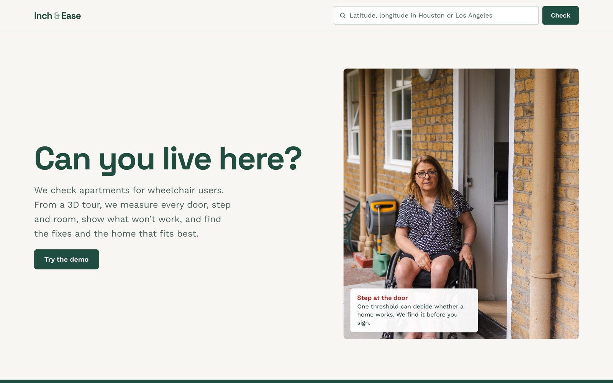

# Inch & Ease

*Measured. Checked. Bought.*

**Can you live here?** Inch & Ease checks apartments for wheelchair users. From a 3D tour it measures every door, step and room, shows what won't work, and finds the fixes and the home that fits best.

Why: about 5 million older Americans who need a grab bar, shower seat or raised toilet seat don't have one, and apartment listings that say "wheelchair accessible" give no door widths (sources in `data/evidence.json` and `data/DATA_NOTES.md`).



An accessibility room planner built solo at HackPrinceton Fall 2026 (Nov 13–15).

**Live:** [inch-and-ease.vercel.app](https://inch-and-ease.vercel.app), the whole app: start page, apartment tours, neighbourhood flyover and street check. Online, the tours play in Matterport's own player beside the full list of problems (the Matterport SDK key only works on localhost, so the 3D pins, shapes and measuring run in the local app). CoStar allowed a temporary public demo for judging as long as the raw data isn't re-published: the server only serves what the pages need.

| What | Where | Run | Tests |
|---|---|---|---|
| The app: start page, 3D tours, neighbourhood flyover, street check, voice | `tour/` (plain ES modules + one Python server) | `uv run --with anthropic python tour/serve.py` → http://localhost:8090 | `node --test tour/*.test.mjs` |
| Slope and building code used by the street check | `src/lib/area.ts`, `buildings.ts` (run by Node through `tour/street_data.mjs`) | | `node src/lib/issues.test.mjs` |
| Public deploy | `scripts/deploy_app.sh` (Vercel container), `scripts/app_env.sh` (keys) | `sh scripts/deploy_app.sh` | |

`data/` (products, checks, profiles, sources) was collected as research before the event; all code was written during the hacking window. Built solo during the event, with Claude Code as the coding assistant.

## Around the building (`tour/street.html`)

Type a latitude and longitude in Houston or Los Angeles, or pick an example. The street check opens in 3D: Vexcel's aerial photo on its ground-elevation model, buildings and trees, and every street and path within 250 m coloured by what you can manage (manual wheelchair, power wheelchair, cane, or your own uphill/downhill limit: blue both ways, amber one way only, red too steep or steps). The sidebar lists the issues near the door, the nearest step-free station, bus stops, mapped kerbs and elevators from OpenStreetMap, and Vexcel's oblique photos of the building from four sides. "Describe how you get around" sends the sentence to Claude, which turns it into slope limits (`/api/ask`).

Vexcel imagery is fetched live through `/api/image` (the key stays on the server); answers are cached in `tour/private/street/` and OpenStreetMap answers in `.osm-cache/` (both git-ignored).

### Credits
- [geotiff.js](https://geotiffjs.github.io) 3.0 (reads Vexcel's elevation GeoTIFFs); [three.js](https://threejs.org) 0.184 with OrbitControls (3D view)
- Vexcel API 2.0 (CoStar hackathon key): ortho, oblique and DTM imagery © Vexcel Imaging US, Inc.
- Map data © [OpenStreetMap](https://www.openstreetmap.org/copyright) contributors (ODbL), via the Overpass API
- Profile presets and the colour idea: [AccessMap](https://www.accessmap.app) (University of Washington Taskar Center); Bolten & Caspi, PLOS ONE 2021

## Voice

Hold Space (or tap the mic) on any page and talk; Chrome's speech recognition hears it. Commands like "night mode", "show the map" or "uphill 10" act at once, and every spoken reply is written by Claude for the conversation (`/api/say`, `/api/agent`, `/api/region`, `/api/walk`) and read in one [Fish Audio](https://fish.audio) voice (`/api/speak`, cached per sentence). Without a voice the reply stays as a caption.

## The 3D tour (`tour/`)

A Matterport tour of a real apartment, checked for a manual wheelchair user against 21 checks: door widths, door steps, turning space, hallway width and essential rooms on the entry floor come from the scan; the bathroom, entry, bed, kitchen and controls are completed in the tour with a question or a two-click measurement. Every problem is a numbered pin and a tinted room in the 3D view, critical ones first (on the route from the entry to the bathroom, bedroom or kitchen). Each card shows measured vs needed, a photo from the tour, a to-scale drawing and every rung of the fix ladder ($0 options, catalogue products by tier, the contractor range), each re-checked against the limit. The Plan tab keeps a budget, the chosen fixes and what stays open, and prints to one page. Claude answers questions by driving the tour (fly to a problem, choose a fix, set a budget).

**Compare a neighbourhood** (`tour/region.html`): a drone view over five real apartments in one area: the aerial photo draped on the ground model, every street within 250 m coloured by slope. Ask by voice or text ("which one is best for my father, he uses a wheelchair?"): Claude writes the narration from the measured numbers only (`/api/region`, structured output), the camera flies to each apartment from hardest to best while the line is spoken, and ends by diving into the winner's 3D tour on its critical problem. Ranking rule, shown on screen: critical problems left after the cheapest fixes, then steep streets, then cost. Area data is prefetched with `node tour/region_fetch.mjs` into `tour/private/region/` (not committed).

Statuses are pass, check with a tape, fail, or not measured yet; nothing is guessed. Results are measured from the scan or by the person, against ADA 2010 reference numbers; confirm with a tape before you sign.

Run it locally (needs the CoStar/Matterport hackathon keys and a Claude API key in `.env.local`):

```bash
uv run --with anthropic python tour/fetch_models.py    # pulls the tours listed in tour/private/tours/index.json (not committed)
# put Matterport's viewer bundle in tour/private/mp: npm pack @matterport/webcomponent@0.1.47, copy built-bundle/ + dist/matterport-viewer.umd.js
uv run --with anthropic python tour/serve.py           # http://localhost:8090
node --test tour/*.test.mjs                            # checks, severity, fix options, re-check, budget
```

Tour data and imagery belong to CoStar / Matterport and are never committed (`tour/private/` is git-ignored; the regression test on the real tours skips without it).

### Credits
- [Matterport web component and Showcase SDK](https://matterport.github.io/developer-docs/) (`@matterport/webcomponent` 0.1.47); CoStar / Matterport hackathon data (not included)
- [three.js](https://threejs.org) 0.184 (Matterport scene objects, loaded from the viewer bundle)
- [Anthropic Python SDK](https://github.com/anthropics/anthropic-sdk-python), Claude Opus 5.5
- Vexcel API (CoStar hackathon key): aerial photo and ground model for the neighbourhood view, © Vexcel Imaging US, Inc. (not included); streets © [OpenStreetMap](https://www.openstreetmap.org/copyright) contributors via Overpass
- Barlow, Space Grotesk and Work Sans (Google Fonts); start-screen photo from [Unsplash](https://unsplash.com/photos/woman-in-wheelchair-at-doorway-mjJwgKMktLg)
- Limits: 2010 ADA Standards and US Access Board research; Housing Enabler item codes (codes only) and HOME FAST item numbers as anchors; fix evidence cited per product in `data/products.json`
